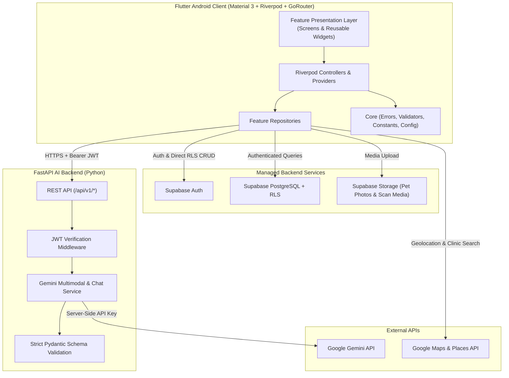

# PawHeal Architecture

PawHeal follows a **feature-based Clean Architecture** on the Flutter client, backed by **Supabase** (PostgreSQL with Row Level Security, Authentication, and Storage) and a **Python FastAPI** AI gateway that securely communicates with the **Google Gemini API**.

## System Architecture



## Directory Structure

```text
lib/
  core/          # Cross-cutting constants, typed exceptions/failures, validators
  config/        # Environment configuration via --dart-define (no secrets)
  routing/       # GoRouter navigation & auth guards (Stage 2+)
  theme/         # Centralized Material 3 palette, typography, spacing (Stage 2)
  shared/        # Reusable cards, buttons, empty/error states (Stage 2+)
  services/      # API client, Supabase wrapper, location & notification services
  features/
    authentication/
    dashboard/
    pets/
    injury_scanner/
    ai_assistant/
    nearby_help/
    first_aid/
    health_tracker/
    profile/

backend/
  app/
    api/v1/      # Versioned FastAPI route handlers
    core/        # Settings, CORS, JWT verification, global error handlers
    models/      # Internal domain models
    schemas/     # Pydantic request/response contracts
    services/    # Gemini multimodal & chat orchestration
    repositories/# Backend data/integration helpers
    main.py      # FastAPI application entrypoint
  tests/         # Pytest unit & endpoint tests

supabase/
  migrations/    # Version-controlled PostgreSQL schema & RLS migrations

test/
  unit/          # Pure Dart unit tests
  widget/        # Flutter widget tests
  integration/   # End-to-end flow tests
```

## Security & Safety Boundaries

1. **Zero Client Secrets**: The Gemini API key lives exclusively in the FastAPI environment (`GEMINI_API_KEY`) and is never compiled into the Flutter binary.
2. **Row Level Security**: Every pet, assessment, chat, and health record table in Supabase enforces `auth.uid() = user_id`.
3. **Medical Guardrails**: AI injury assessments never claim a definitive veterinary diagnosis or fabricate confidence scores, and always elevate emergency symptoms to immediate veterinary care.
